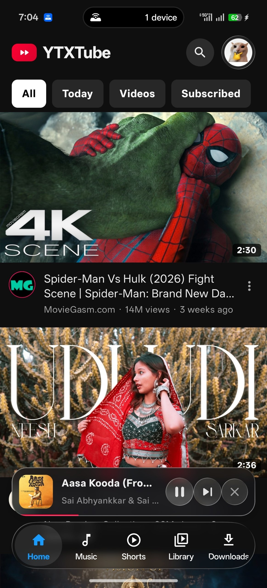
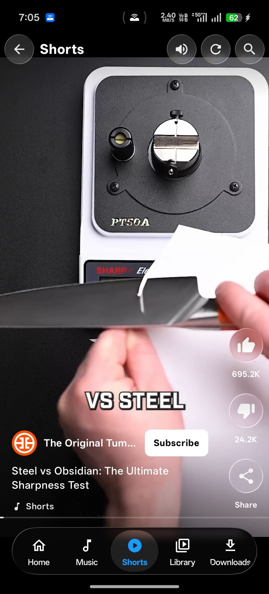
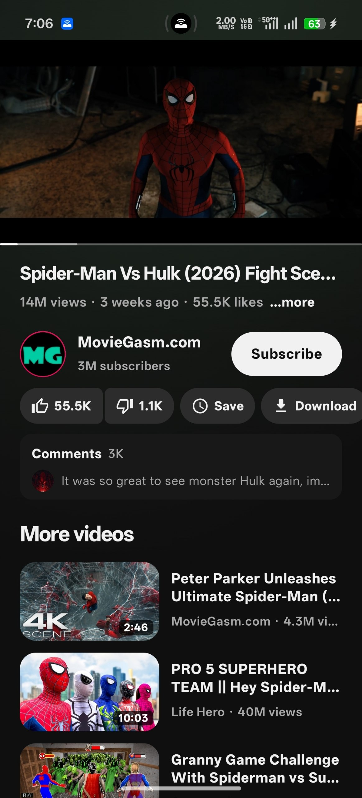
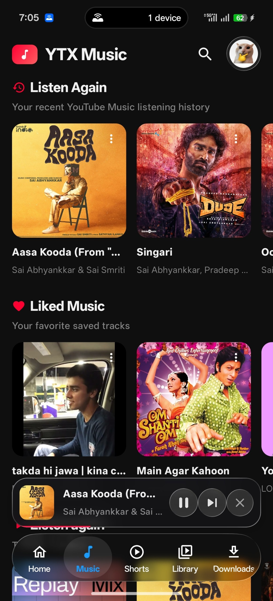
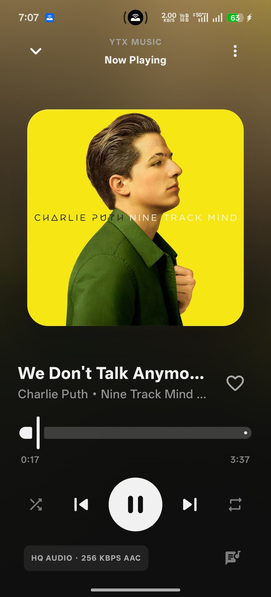
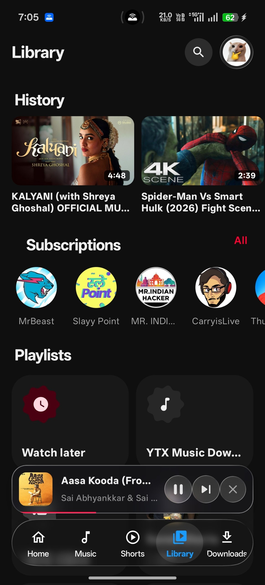
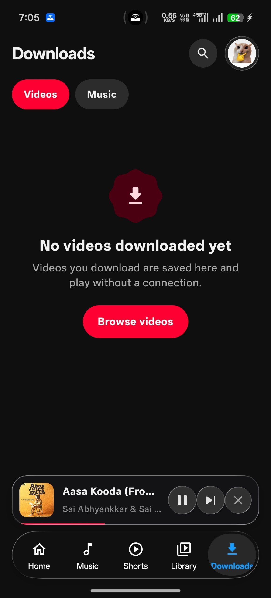
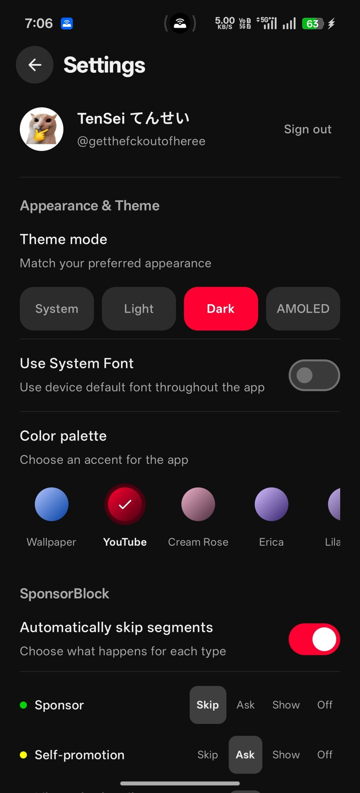

# YTXTube

A lightweight YouTube and YouTube Music client with a modern Liquid Glass UI, ad-free playback, endless personalised Shorts, synced Apple Music-style lyrics, and high-quality downloads.

## Features

- Liquid Glass interface across the player, Shorts, fullscreen controls, settings and music mini player
- Ad-free YouTube and YouTube Music playback
- Personalised Shorts feed with a one-tap fresh batch and loading animation
- Synced lyrics with an Apple Music-style animated lyric view
- High-quality video and audio downloads
- Search, channels, playlists and community posts
- Background playback and picture-in-picture
- Android TV support too: the same APK runs on TV with full D-pad navigation

## Download

[Download the latest YTXTube APK](https://github.com/Koustubh12345/YTXTube/releases/latest)

Version 2.0.0 · Android 7.0+ · one APK for phones, tablets and Android TV.

**Base:** [FlashTube](https://github.com/JustaThinker/FlashTube)

## Screenshots

<table>
  <tr>
    <td align="center"><br><sub>Home</sub></td>
    <td align="center"><br><sub>Shorts</sub></td>
    <td align="center"><br><sub>Video player</sub></td>
    <td align="center"><br><sub>Music</sub></td>
  </tr>
  <tr>
    <td align="center"><br><sub>Music player</sub></td>
    <td align="center"><br><sub>Library</sub></td>
    <td align="center"><br><sub>Downloads</sub></td>
    <td align="center"><br><sub>Settings</sub></td>
  </tr>
</table>

## Build

```bash
./gradlew :app:assembleRelease
```

The release APK is written to `app/build/outputs/apk/release/app-release.apk`.

Licensed under GPLv3. See [LICENSE](LICENSE).
