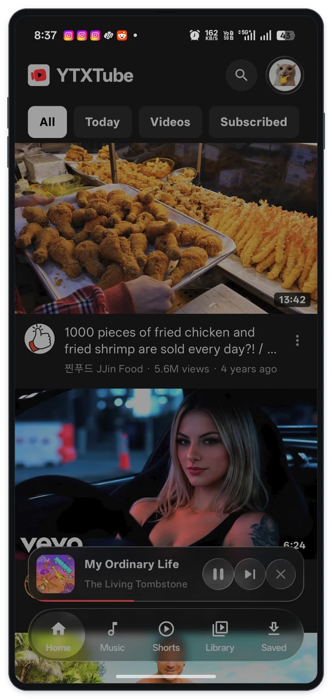
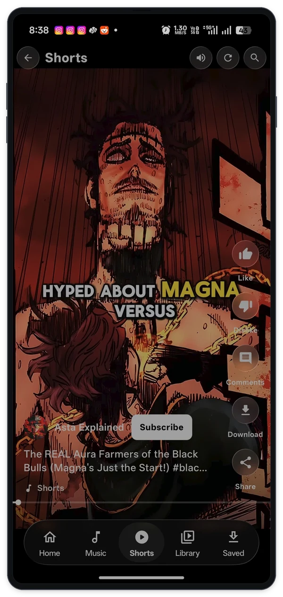
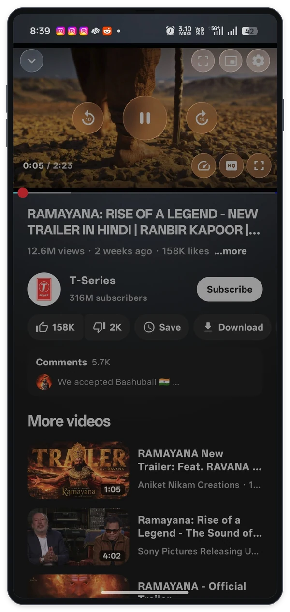
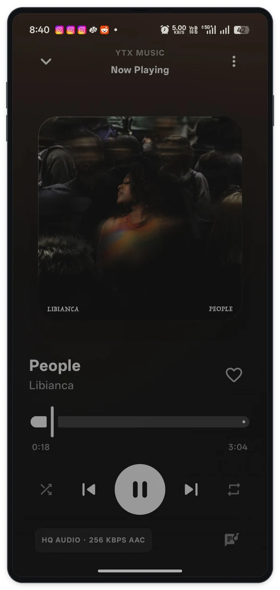
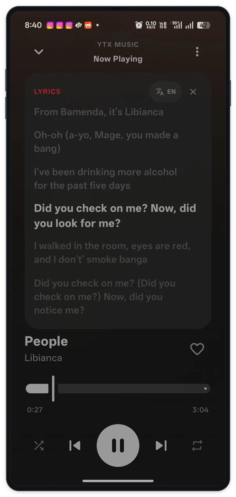
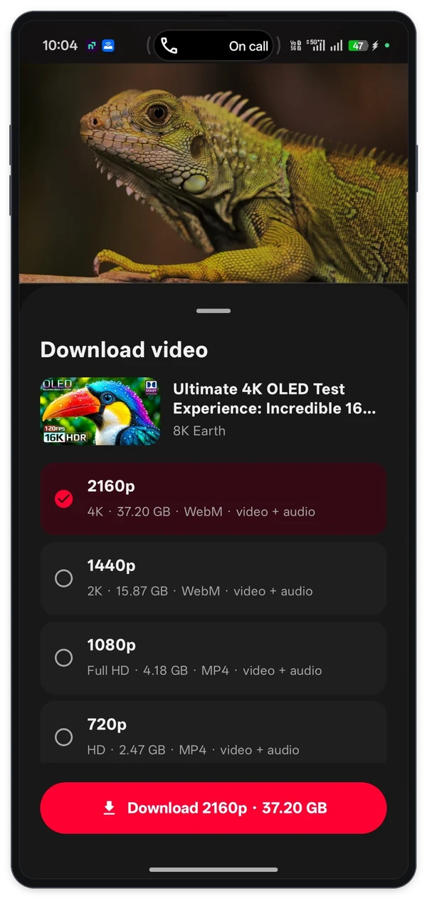
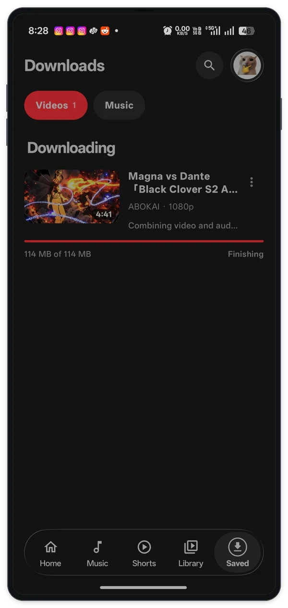
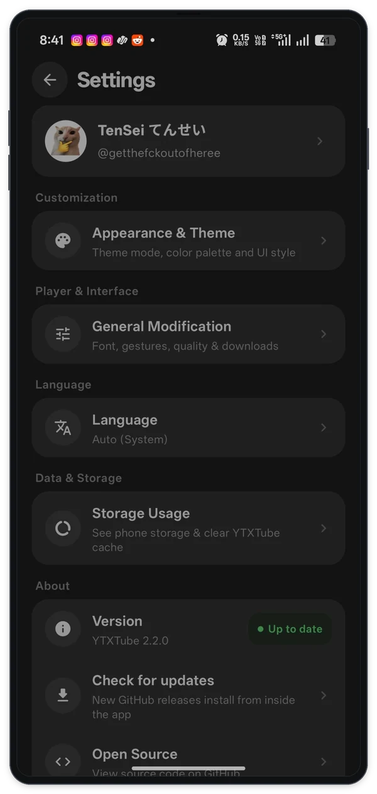

<div align="center">

# YTXTube

**A lightweight YouTube and YouTube Music client with a modern Liquid Glass UI, ad-free playback, endless personalised Shorts, synced Apple Music-style lyrics, and high-quality downloads.**

[](https://github.com/Koustubh12345/YTXTube/releases/latest)
[](https://github.com/Koustubh12345/YTXTube/releases/latest)
[](LICENSE)

<br/>

[**Download Latest APK (v2.2.0)**](https://github.com/Koustubh12345/YTXTube/releases/latest)

</div>

---

## Features

- **Liquid Glass UI** — Frosted glass aesthetic across the player, Shorts, fullscreen controls, settings, and music mini player
- **Multilingual Support** — Multiple languages support across the entire app
- **2 Mini Player Styles** — Modern YouTube-style floating draggable miniplayer and classic Liquid Glass dock
- **Ad-Free Playback** — Ad-free YouTube and YouTube Music playback
- **Personalised Shorts** — Endless Shorts feed with a one-tap fresh batch and loading animation
- **Synced Lyrics** — Synced lyrics with an Apple Music-style animated lyric view
- **High-Quality Downloads** — High-speed video and audio downloads up to 4K / HDR
- **4K HDR Playback** — 4K HDR playback and customizable fixed resolution quality lock
- **Search & Explore** — Search, channels, playlists, and community posts
- **Background & PiP** — Background playback and Picture-in-Picture
- **Android TV Support** — Dedicated TV mode with full D-pad remote navigation

---

## Download

[**Download Latest APK (v2.2.0)**](https://github.com/Koustubh12345/YTXTube/releases/latest)

> **Version 2.2.0** · Android 7.0+ · One universal APK for phones, tablets, and Android TV.

---

## Screenshots

<p align="center">
  
  
  
  
</p>
<p align="center">
  
  
  
  
</p>

---

## Disclaimer

YTXTube is an independent, open-source project and is **not affiliated with or endorsed by Google LLC or YouTube**. All content is streamed directly from YouTube's servers for personal, educational use. Provided "as is" under the GPL-3.0 license without warranty; users are responsible for complying with YouTube's Terms of Service and applicable copyright laws.

---

## Base

Built upon [FlashTube](https://github.com/JustaThinker/FlashTube).

---

## Build

```bash
./gradlew :app:assembleRelease
```

The release APK is written to `app/build/outputs/apk/release/app-release.apk`.

---

## License

Licensed under GPLv3. See [LICENSE](LICENSE).
